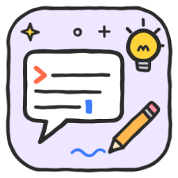

<p align="center">
  
</p>

<h1 align="center">Prompt studio — Claude Skill</h1>

<p align="center">
  <a href="LICENSE"></a>
  
  
</p>

<p align="center">
📚 Faz parte da <b><a href="https://github.com/mozuraa/claude-skills">biblioteca de skills de mozuraa</a></b> · Part of <b><a href="https://github.com/mozuraa/claude-skills">mozuraa's skills library</a></b>
</p>

<p align="center"><b><a href="#português">Português</a> · <a href="#english">English</a></b></p>

---

## Português

Uma [skill](#o-que-é-uma-skill) para o **Claude** (Claude Code, app Claude e claude.ai) que **cria e melhora prompts para qualquer IA** — Claude, ChatGPT, Gemini, agentes de programação, system prompts de assistentes e GPTs, prompts de API, e geradores de imagem, vídeo e música.

A diferença: **antes de escrever uma palavra, percebe o que queres mesmo.** Uma prompt é o teu raciocínio posto em palavras — a IA só consegue seguir a lógica que está na página. Por isso a skill começa sempre por compreender o **objetivo** (o que queres e porquê), a **lógica** (como a tarefa se faz) e o **raciocínio** (porquê cada regra, o que pesa mais, o que é "bom" para ti), confirma isso contigo e só depois escreve a melhor prompt possível.

### Os dois modos

| | Modo | Para quê |
|---|---|---|
| 🛠️ | **Criar** | Tens um objetivo (mesmo vago) e queres uma prompt nova |
| ✏️ | **Editar** | Tens uma prompt e queres melhorá-la, perceber porque falha, encurtá-la, traduzi-la ou passá-la para outro modelo |

```
🛠️ Criar:  🧭 Compreender ─► ✋ ─► 📐 Desenhar ─► ✍️ Escrever ─► 🔍 Rever ─► 📦 Entregar ─► 🔁 Iterar
✏️ Editar: 🔎 Reconstruir a intenção ─► ❓ O que falha ─► ✋ ─► 🩺 Diagnóstico ─► ✍️ Reescrever ─► 📦 Antes/depois
```

### O que recebes

- **🎯 O que percebi** — o mapa da tua intenção em poucas linhas.
- **✨ A prompt** — pronta a copiar, com variáveis `{{...}}` onde faltam dados (nunca factos inventados).
- **🧠 Porque está assim** — cada decisão ligada ao teu objetivo.
- **🔧 Como usar** — onde colar, o que preencher, que definições usar.
- **🧪 Como testar** — casos de teste, incluindo um caso-limite.
- **📊 Nota /10** — em 5 dimensões (objetivo, contexto, lógica, formato, robustez), honesta, e o que falta para chegar a 10. No modo Editar, **antes → depois**, com a tabela do que mudou e porquê.

### Quando é ativada

O Claude usa-a sozinho quando dizes algo como:

- "Faz-me uma prompt para o ChatGPT responder a clientes"
- "Melhora esta prompt, sai sempre genérico"
- "Porque é que o meu GPT ignora as minhas instruções?"
- "Escreve o system prompt do meu bot"
- "Quero uma prompt para o Midjourney"
- "Passa esta prompt do ChatGPT para o Claude"
- "Escreve um CLAUDE.md para o meu projeto"

Também a podes chamar com `/prompt-studio`.

### O que sabe

| Guia | O que tem |
|---|---|
| [`compreender.md`](references/compreender.md) | As três camadas (objetivo, lógica, raciocínio), técnicas de entrevista, perguntas por tipo de tarefa, como ler uma prompt existente, o mapa da intenção |
| [`anatomia.md`](references/anatomia.md) | Os 10 blocos de uma prompt, a ordem certa, como escolher a arquitetura, cadeias de prompts, variáveis |
| [`tecnicas.md`](references/tecnicas.md) | 17 técnicas com exemplos antes/depois: o teste do colega, dar o porquê, tags, exemplos, raciocínio, citações, formato, agir vs. sugerir... |
| [`destinos.md`](references/destinos.md) | O que muda em cada destino: assistentes de conversa, modelos com raciocínio, system prompts, API, agentes de programação, imagem, vídeo, música, voz — e como adaptar entre eles |
| [`checklist.md`](references/checklist.md) | 5 testes rápidos, lista de verificação, 20 anti-padrões, critérios da nota, diagnóstico a partir de uma resposta má |
| [`assets/modelos/`](assets/modelos/) | Modelos prontos: universal, system prompt, tarefa para agente, imagem/vídeo/música |

Vê os exemplos completos: [criar](examples/criar.md) · [editar](examples/editar.md).

### Princípios

- **Compreender antes de escrever** — nunca escreve às cegas.
- **Nunca muda o teu objetivo** sem te perguntar.
- **Não inventa factos** — o que não sabe fica como variável ou pergunta.
- **Opinião honesta** — se a tua prompt já é boa, diz isso e mexe pouco; se a IA não é a ferramenta certa, também diz.
- **Tamanho proporcional** — tarefa simples, prompt curta.
- **Ética** — não escreve prompts para contornar a segurança de outras IAs, enganar pessoas ou fazer mal.

### Instalação

**Claude Code (para todos os teus projetos)**

```bash
git clone https://github.com/mozuraa/claude-skill-prompt-studio.git ~/.claude/skills/prompt-studio
```

**Claude Code (só num projeto)** — dentro da pasta do projeto:

```bash
git clone https://github.com/mozuraa/claude-skill-prompt-studio.git .claude/skills/prompt-studio
```

Abre uma sessão nova para a skill ser carregada.

**Pela biblioteca (Claude Code):**

```
/plugin marketplace add mozuraa/claude-skills
/plugin install ia@mozuraa-skills
```

**App Claude / claude.ai**

1. Nesta página, carrega em **Code → Download ZIP**.
2. No Claude, abre as **Definições** e procura a secção **Skills** (em *Capacidades*).
3. Carrega o ZIP.

> As skills personalizadas precisam de estar ativadas na tua conta/organização.

### Atualizar

```bash
cd ~/.claude/skills/prompt-studio && git pull
```

### O que é uma skill?

Uma skill é uma pasta com um ficheiro `SKILL.md`: um nome, uma descrição de quando deve ser usada e instruções. O Claude lê só a descrição até ela ser útil; quando o pedido encaixa, carrega as instruções e segue-as. Não instala programas nem corre código — é só texto.

### Estrutura

```
claude-skill-prompt-studio/
├── SKILL.md                  # a skill: modos, fase Compreender, entrega, nota
├── references/
│   ├── compreender.md        # objetivo, lógica e raciocínio; entrevista; ler prompts
│   ├── anatomia.md           # os 10 blocos, arquitetura, cadeias, variáveis
│   ├── tecnicas.md           # 17 técnicas com antes/depois
│   ├── destinos.md           # conversa, raciocínio, system, API, agentes, imagem, vídeo, música, voz
│   └── checklist.md          # verificação, anti-padrões, nota /10, diagnóstico
├── assets/modelos/
│   ├── universal.md
│   ├── system-prompt.md
│   ├── agente.md
│   └── imagem-video-musica.md
├── examples/
│   ├── criar.md
│   └── editar.md
├── icon.svg
├── README.md
├── CHANGELOG.md
└── LICENSE
```

### Contribuir

Uma técnica que falta? Um destino novo (uma ferramenta de IA que usas)? Uma prompt que a skill melhorou mal? Abre uma *issue* ou um *pull request*.

### Licença

[MIT](LICENSE) — podes usar, alterar e partilhar livremente, mantendo o aviso de licença.

---

## English

A [skill](#what-is-a-skill) for **Claude** (Claude Code, the Claude app and claude.ai) that **creates and improves prompts for any AI**: Claude, ChatGPT, Gemini, coding agents, system prompts for assistants and GPTs, API prompts, and image, video and music generators.

What sets it apart: **before writing a single word, it works out what you actually want.** A prompt is your reasoning put into words, and the AI can only follow the logic that's on the page. So the skill always starts by understanding the **goal** (what you want and why), the **logic** (how the task is done) and the **reasoning** (why each rule exists, what matters most, what "good" means to you). It confirms that with you and only then writes the best prompt it can.

### The two modes

| | Mode | For |
|---|---|---|
| 🛠️ | **Create** (*Criar*) | You have a goal (even a vague one) and want a new prompt |
| ✏️ | **Edit** (*Editar*) | You have a prompt and want to improve it, find out why it fails, shorten it, translate it or move it to another model |

### What you get

- **🎯 What I understood:** a short map of your intent.
- **✨ The prompt:** ready to copy, with `{{...}}` variables where data is missing, never invented facts.
- **🧠 Why it's built this way:** each decision tied to your goal.
- **🔧 How to use it:** where to paste it, what to fill in, which settings to use.
- **🧪 How to test it:** test cases, including an edge case.
- **📊 A /10 score:** an honest score across 5 dimensions (goal, context, logic, format, robustness), plus what it would take to reach 10. In Edit mode you get **before → after**, with a table of what changed and why.

### When it triggers

Claude uses it on its own when you say things like "write me a prompt for…", "improve this prompt", "why does my GPT ignore my instructions?", "write the system prompt for my bot", "a Midjourney prompt for…", "port this prompt from ChatGPT to Claude" or "write a CLAUDE.md for my project". You can also call it with `/prompt-studio`.

### What it knows

Five guides: understanding intent, prompt anatomy, 17 techniques with before/after examples, destinations (chat assistants, reasoning models, system prompts, APIs, coding agents, image, video, music, voice) and a review checklist with 20 anti-patterns. It also has ready-made templates. Everything is written in Portuguese, but Claude replies in your language. See the full [create](examples/criar.md) and [edit](examples/editar.md) examples.

### Principles

- **Understand before writing.** It never writes blind.
- **It never changes your goal** without asking.
- **No invented facts.** Anything it doesn't know becomes a variable or a question.
- **Honest opinion.** If your prompt is already good, it says so and changes little. If AI isn't the right tool, it says that too.
- **Length to match the task.** A simple task gets a short prompt.
- **Ethics.** It won't write prompts to bypass other AIs' safety, deceive people or cause harm.

### Installation

**Claude Code (all your projects)**

```bash
git clone https://github.com/mozuraa/claude-skill-prompt-studio.git ~/.claude/skills/prompt-studio
```

**Claude Code (one project only)**, from the project folder:

```bash
git clone https://github.com/mozuraa/claude-skill-prompt-studio.git .claude/skills/prompt-studio
```

Start a new session so the skill loads.

**From the library (Claude Code):**

```
/plugin marketplace add mozuraa/claude-skills
/plugin install ia@mozuraa-skills
```

**Claude app / claude.ai**

1. On this page, click **Code → Download ZIP**.
2. In Claude, open **Settings** and find the **Skills** section (under *Capabilities*).
3. Upload the ZIP.

> Custom skills must be enabled for your account or organization.

### Updating

```bash
cd ~/.claude/skills/prompt-studio && git pull
```

### What is a skill?

A skill is a folder with a `SKILL.md` file containing a name, a description of when it should be used, and instructions. Claude only reads the description until the skill becomes relevant; when a request matches, it loads the instructions and follows them. A skill installs no programs and runs no code: it's just text.

### Contributing

Missing a technique? A new destination (an AI tool you use)? A prompt the skill improved badly? Open an issue or a pull request.

### License

[MIT](LICENSE): free to use, modify and share, as long as you keep the license notice.
